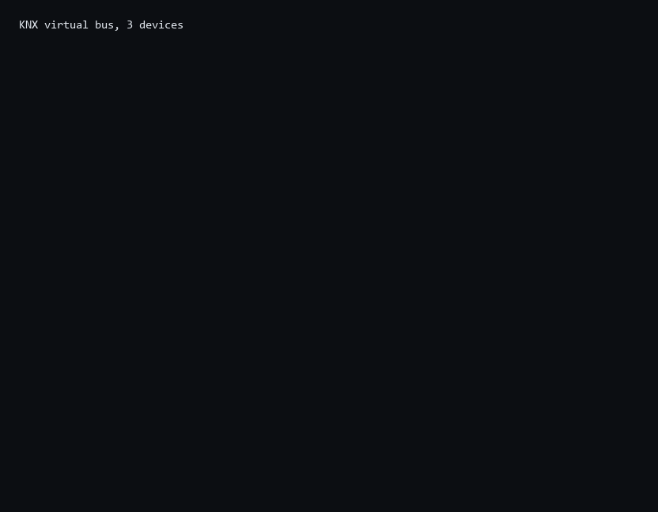

# KNX

用 MoonBit 实现的 KNX 报文与数据点工具链。给楼宇总线一个不依赖网关厂商 SDK 的选择：帧、地址、数据点、设备模型，都可以直接编进程序。

当前版本尚未发布到 mooncakes，接入方式为仓库源码或路径依赖。



```text
BC 11 01 11 01 81 00 81 BC
│  │     │     │  │  └── TPDU：GroupWrite，值 true
│  │     │     │  └───── NPCI：组地址，长度 2 字节
│  │     │     └──────── 目的组地址 2/1/1
│  │     └────────────── 源地址 1.1.1
│  └──────────────────── 控制字节
```

上面这条帧来自 `moon run cmd -- demo`，不是示意。

## 能做什么

| 层 | 内容 | 状态 |
|---|---|---|
| 地址 | 个体地址 `1.2.3`、组地址 `1/2/3`，解析/格式化/打包 | 可用 |
| 报文 | TP1 标准帧与扩展帧：控制、源、目的、NPCI、TPDU、校验 | 可用 |
| 服务 | GroupRead / GroupWrite / GroupResponse，短值内联与长值带长度 | 可用 |
| 帧封装 | FT1.2：`10 02 … 10 03`，`0x10` 双写转义 | 可用 |
| 数据点 | DPT-1 / 5 / 6 / 7 / 8 / 9 / 10 / 11 / 12 / 13 / 14 / 16 / 17，含百分比与场景 | 可用 |
| 设备 | 组对象表、写入更新、读取应答 | 可用 |
| 总线 | 虚拟总线：写广播、读收集应答、活动轨迹 | 可用 |
| 网关 | cEMI L_Data.req/ind/con，与 TP1 报文互转 | 可用 |
| KNX/IP | 固定头、SEARCH/DESCRIPTION、CONNECT、TUNNELLING、ROUTING、设备管理 | 可用 |
| 工程表 | 组地址 ↔ DPT 配置、重复与越界校验、报告 | 可用 |
| 客户端 | 隧道状态机：连接、序号、Ack、重发、入站应答、断开 | 可用 |
| 监控 | 帧解释：服务、通道、cEMI、telegram、APCI | 可用 |
| 工具 | `decode` / `demo` / `frames` / `soak` / `cemi` / `tunnel` / `search` / `device` / `plan` / `desc` / `mon` | 可用 |
| 扩展帧 | 扩展帧格式 | 未实现 |
| 安全 | KNX Secure | 未实现 |

没实现的部分在代码和文档里都标为缺失，不会用占位实现冒充。

## 跑起来

```bash
moon run cmd -- demo
moon run cmd -- decode "BC 11 01 11 01 81 00 81 BC"
moon run cmd -- frames
moon run cmd -- soak 200
moon run cmd -- cemi "1100BC8011011101810081"
moon run cmd -- tunnel
moon run cmd -- search
moon run cmd -- device
```

`demo` 会在一台交换器、一盏灯、一个调光器和一个温度传感器之间跑一轮：开灯、读状态、调到 80、上报 21.5 °C，然后打印轨迹和经过总线的五条帧。

## 目录

```
addrmodel/  个体地址与组地址
busframe/   FT1.2 串口帧
telegram/   TP1 报文与组服务
datapoint/  DPT 编解码
device/     组对象与读写行为
net/        虚拟总线与轨迹
cemi/       cEMI L_Data 与 TP1 互转
knxip/      KNX/IP 头、发现、隧道与路由帧
project/    组地址 ↔ DPT 工程表
gateway/    隧道客户端状态机
trace/      帧解释与抓包渲染
cmd/        命令行
```

依赖是单向的：`telegram` 依赖 `addrmodel`，`device` 依赖前两者与 `datapoint`，`net` 把它们接起来，`cmd` 只做输入输出。总线不认识电气层，设备也不认识总线。

## 三个设计选择

**转义只做一处。** FT1.2 用 `0x10` 既作起始又作结束，因此正文里的 `0x10` 必须双写。这条规则只放在 `busframe` 里，其他层看不到。

**短值内联。** 组服务的低六位可以携带 0..63 的小值，也可以表示后续字节数；一条布尔写入因此只有两个字节的 TPDU，不需要额外的长度字段。

**2 字节浮点按规则算。** DPT-9 是「1 位符号 + 4 位指数 + 11 位尾数」，值等于 `0.01 × 尾数 × 2^指数`。21.0 °C 必须用指数 1 才装得下，所以编码是 `0C 1A`，而不是把两个字节当整数。

## 边界

- 只做报文与设备模型，不做电气层、不做总线仲裁时序。
- KNX Secure、ETS 工程导入、总线仲裁时序未实现。
- 没有 ETS 工程文件导入；组地址由调用方配置。

见 [`docs/architecture.md`](docs/architecture.md)、[`docs/protocol.md`](docs/protocol.md) 与 [`docs/proposal.md`](docs/proposal.md)。

## 验证

```bash
moon check --deny-warn
moon test --deny-warn     # 95 个用例
moon fmt --check
```

测试覆盖地址打包、报文往返与校验失败、FT1.2 转义、七种 DPT 的编码与边界、设备读写、总线广播与应答收集。

## 许可

Apache-2.0，见 `LICENSE`。依据 KNX 公开标准（ISO/IEC 14543-3）的报文结构自行实现，无第三方代码。
